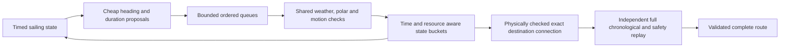

# Meridian standalone routing engine

Meridian is an additional experimental planner in Weather Routing 1.44.0 and
xWeatherRouting 2.11.0. Select it as an individual method in Advanced, or tick
its Auto/All checkbox to include it after Atlas and before Standard. It is
unticked by default; each mode remembers its choice. Existing solver
implementations, saved bit positions and default selections are preserved. See [the measured evaluation](MERIDIAN-EVALUATION-20261123.md).

## Search model

A state records position, time, incoming heading, tack, propulsion/sail profile,
mode duration, fuel, manoeuvres, risk, waiting and departure-margin access.
Wind/current-dependent travel makes position alone insufficient: the same place
at another time can have a different future. Earlier arrival does not generally
dominate a later state with different weather or resources.

Meridian ranks cheap motion proposals before paying for detailed motion checks.
Promising proposals use the shared motion kernel, polar/performance provider,
weather/current resolution and safety adapter. It shares preflight and validation
code; it does not invoke any existing engine's route-search implementation.

A hierarchical geographic sketch orders detours: fine endpoint access, a coarse
offshore connection, and a wider fallback for nearby endpoints separated by a
long peninsula. It is advisory. Its vertices never become sailing legs without
weather-dependent integration, and no candidate must follow the sketch.
Continuous projection along the sketch avoids artificial cost pits at vertices.

The primary queue uses elapsed time plus a weighted estimate of remaining travel;
periodic elapsed-time queue pops preserve some wider exploration. Pending work is
bounded in one shared pool so removing a proposal also removes its other queue
entry. There are at most 40,000 pending proposals and 30,000 retained nodes by
default. The default total proposal ceiling is 2,000,000, further limited by the
request's work and retained-state allowances. These are work/storage caps, not a
claim that the machine has exhausted RAM.

The planner tries a 48-heading full-circle fan, supplemented by the destination
bearing and incoming heading. Its base separation is 7.5 degrees. **Max Search
Angle and Heading Separation do not tune this method.** Their saved values are
preserved for other methods; the controls are disabled while Meridian is selected.
Physical true/apparent wind-angle limits, the boat's performance, current effects,
land, boundaries, hazards, depth and other applicable safety/resource constraints
continue to apply to checked motions and final replay.

Clearance hints select short coastal and longer offshore steps. The nominal time
step is an offshore ceiling, capped at six hours initially. The first attempt
uses coastal steps up to 15 minutes, reducing further near arrival. Forty percent
of the proposal allowance is reserved for refinement; any unspent first-attempt
allowance is also available. Refinement uses coastal steps up to five minutes and
offshore steps up to one hour. It reopens the final ten sailed miles of a checked
prefix, preserving exact departure time and all predecessor/resource history,
and rebuilds local advisory geography at the recovered frontier. The entire
joined route must still pass fresh independent replay from the original start.

## Contracts and limits

- Approximate spatial/time buckets and bounded alternative labels can discard a
  useful future. Weighted ordering is not an admissible ETA bound. Global
  optimality and completeness are not established.
- A search allowance, empty bounded queue or unavailable-weather result does not
  prove that no feasible passage exists. Completed alternatives from another
  engine can demonstrate a missed route.
- An exact-destination connection must be physically sail-able and replayed. A
  near miss, the geographic sketch or a straight final chord cannot establish
  completion.
- Comfort-alternative comparison and the other engines' effort/reverse/adaptive
  controls are unavailable for this experimental method. Meridian currently
  accepts fastest-passage objectives with the existing safety constraints.
- Cancellation discards delivered route legs and preserves diagnostic evidence.
  The new engine creates no additional worker threads of its own. Existing
  opt-in calculation helpers and shared cache policies continue to apply.
- Chart-aware checks use the optional existing OpenCPN service. Ordinary GSHHG
  routing works on stock OpenCPN. Enforced chart-depth checks require a host with
  that service and do not silently downgrade when it is absent.

## Shared adapter and report changes

Every method now uses the complete requested GSHHG segment buffer, including end
caps. The previous offset/diagonal probes could leave gaps or reject space
outside the actual buffer. Existing bounded water-endpoint access remains.
Missing shoreline data continue to reject admission.

Copy diagnostic report reads fresh progress when clicked, retains the active
method behind a weather/chart wait label and distinguishes search progress from
a validated arrival. It checks that retained route pointers still belong to the
route list before dereferencing them. Configured and effective nominal time steps
are distinct; engine-managed steps are explicitly reported as such. Count
allowances and allocation failures receive different explanations. Upgrading to
these feature releases preserves existing boats, polars and examples.

## Research context

The implementation independently combines established ideas rather than claiming
a new optimal-search theorem. [Lazy edge evaluation](https://publications.ri.cmu.edu/storage/publications/pub_files/2016/3/paper-lazysp.pdf)
informs checking expensive motions after cheap ordering. [Time-dependent sailing
search](https://exia.informatik.uni-ulm.de/fruehwirth/sail.pdf) explains why wind,
current and boat performance belong in the travel model. [Multi-heuristic search](https://www.cs.cmu.edu/~venkatrn/papers/ijrr16.pdf)
is relevant background for using different ordering views, but Meridian is not a
formal implementation of MHA* and does not inherit its bounds.
