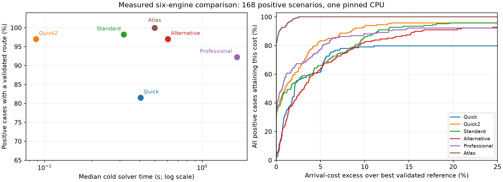

# Atlas research results and qualifications

Atlas is implemented as a distinct experimental sixth engine on Weather
Routing 1.32 (`1fa62c7`), in the isolated `experimental/sixth-routing-engine`
worktree. The five baseline libraries and shared physical/validation code are
unchanged: [48-file integrity check](baseline-integrity.json). The default
engine and default Auto/All memberships are unchanged. Atlas can be selected
alone or explicitly enabled in either portfolio.

The selected method combines continuous heading/time boundary-value solves,
polar velocity geometry, continuous route-shape probes, an adaptive spatial
decision graph, multiple arrival histories and coarse time-dependent Bellman
feedback. No existing engine is invoked by Atlas. Read the
[mathematical formulation](mathematics.md), [independent literature
review](literature.md) and [API/build guide](../../docs/atlas-engine.md) for
the reasoning and approximation boundaries.

The standalone `onIncumbent` callback publishes strictly improving validated
routes synchronously, and `improvementAttempts=0` returns the first valid
candidate. Default bounded continuation seeks better arrivals. The current
host accepts the route when that solve completes; it does not yet expose
intermediate incumbents as selectable completed routes. Cancellation clears
the result, while resource exhaustion can retain a previously validated route.

## Comparison protocol

The final matrix contains 178 scenarios: 168 intended-positive problems and
10 deliberately infeasible or unavailable-data/safety negatives. It includes
128 seeded generated cases in eight families, open ocean up to 1,800 NM,
dateline/high-latitude routes, upwind/downwind sailing, island chains, slalom,
a U-shaped trap, offset/narrow passages, timed gates with and without waiting,
tidal currents, detached favourable jets, wind reversal, a moving storm,
motoring, full-resolution GSHHG Provincetown/Hadley endpoints and nine covered
real-GRIB routes. Two further real-GRIB inputs deliberately lack required
current coverage. Real GRIB/polar files are referenced by path and hash,
rather than embedded; these are deterministic historical replay tests.

All six engines use the same physical fixtures, forecast/current interpolation,
polar tables, safety provider, request constraints, independent validator and
10-second solve deadline. Professional receives its host-style hardened Quick
incumbent, sharing that deadline. This is a controlled finite-budget
comparison, not every possible Professional effort/recovery setting. Actual
Auto uses different Professional recovery effort; offline component portfolio
results are not presented as measured Auto timings.
Deadlines are cooperative: provider calls and cleanup can overrun them, and
the measured wall times include those overruns rather than truncating to 10 s.

The runner freezes its executable and records source/input hashes, compiler
settings and machine information. Solver processes run serially, pinned to
logical CPU 4. No builds, sanitizer tests, oracle jobs or native application
replays run alongside the qualified timing matrix. Each engine/scenario starts
a fresh process. Its second run retains provider caches, but search structures
are rebuilt. Operating-system disk caches are not flushed. Setup/GRIB decoding,
solver and independent audit have separate times; solver medians are not
end-to-end OpenCPN startup measurements. CPU time, provider queries, source
work and memory are retained in the raw records. Process failures count as
failures and missing matrix entries are checked.

The qualification machine is an Intel Core i7-12700H on Linux x86-64,
Release C++20 with `-O3 -DNDEBUG`. This measures one pinned CPU, not a
parallel/GPU implementation or a portable timing guarantee.

The raw matrix analysis compares ETAs with the best result across its cold
and warm runs. The table and figure below additionally use a broader best-known
reference pool: faster historical synthetic control sequences are replayed
through the current physical model and independent validator before being
accepted. Neither reference pool is a certified continuous optimum. Separate
oracles establish quality on small special cases. The suite informed
development, so a fresh unseen regional/forecast holdout is still needed
before a default-engine decision.

## Six-engine results

All **2,136 records** are present, with no process errors or missing entries.
All six engines reject every deliberate negative in both repeats.
The following medians include positive-case failures and their calculation cost;
ETA p95 is conditional on valid routes and uses the broader best-known pool.
Ratios above 1 mean a later arrival. RSS includes provider data and the audit.

| Engine | Valid cold / warm, of 168 | Cold median s | Warm median s | ETA p95 / best known | Median peak RSS MiB |
|---|---:|---:|---:|---:|---:|
| Quick | 137 / 137 | 0.4065 | 0.3299 | 1.0717 | 83.8 |
| Quick2 | 163 / 163 | 0.0881 | 0.0673 | 1.0897 | 25.2 |
| Standard | 165 / 166 | 0.3182 | 0.2177 | 1.1405 | 78.5 |
| Alternative | 163 / 163 | 0.6056 | 0.4196 | 1.2093 | 78.7 |
| Professional | 155 / 155 | 1.6643 | 1.4456 | 1.0989 | 120.5 |
| Atlas | 168 / 168 | 0.4993 | 0.4654 | 1.0120 | 37.8 |

Atlas has the highest tested standalone coverage and the lowest ETA p95,
but Quick2, Standard and Quick have lower median calculation times. Against
Professional's 155 common valid cases, Atlas has earlier arrivals in 89 and
is over 1% later in six. The median paired Professional/Atlas computation
ratio is 3.68; total positive cold solver time is 436.50 s versus 91.31 s.
These observations support a useful coverage/quality/computation tradeoff,
not universal per-route Pareto dominance.

Atlas is within 1% of the broader best-known reference on **156/168** cases;
its ETA p95 is **1.20%** and its worst excess **2.51%** (`generated_0087`).
Other remaining outliers include the two north-Anglesey departures and
short jet shapes. Earlier experiments improve 12 reference costs after 13
fresh successful control replays, including `generated_0071` at 12,917 s
versus the final default's 13,001 s. All candidates reproduce actual endpoints
without snapping and pass the current validator. The replay client also
rejects a deliberately altered heading. It only supports identical synthetic
physical scenarios; real-route references remain the controlled matrix's
validated results. Historical timing never contributes to the timing table.

### Portfolio value and concrete head-to-head wins

Atlas improves the best five-engine cold arrival by more than one second on
**97 cases**. It also supplies the sole cold valid route on
`long_ocean_variable`, taking cold All coverage from **167/168 to 168/168**.
With warm caches Standard completes that case at 9.50 s and finds a better
passage time (763,870 s versus Atlas's 771,743 s); warm All coverage is already
168/168. Atlas completes it at 1.32/1.24 s cold/warm. The coverage increment is
therefore explicitly budget/cache-dependent, not proof that the baselines
cannot solve the route. The offline Quick-plus-Atlas component portfolio also
covers all 168 cases in both repeats.

| Case | Atlas passage | Best five-engine cold passage | Improvement |
|---|---:|---:|---:|
| Slalom | 5h 00m 09s | 5h 11m 32s | 11m 23s (3.65%) |
| Generated tide 19 | 3h 13m 18s | 3h 30m 13s | 16m 55s (8.05%) |
| Real Pacific long | 172h 32m 24s | 192h 32m 24s | 20h (10.39%) |

The cold and warm portfolio each has 97 strict ETA improvements. These are
component comparisons, not measurements of the host Auto scheduler's elapsed
time. All preserves other engines' better candidates. Atlas does not win every
case: the Pacific north route, for example, is 237 s later than Quick2 over
roughly 60 hours, and the U-trap and some jets also favour other searches.

### CPU and provider work

These are positive-case cold medians of public provider-interface calls.
They exclude the fresh external audit. Cache internals can perform additional
work; the counters are not counts of raw GRIB decode operations.
Generated work means each baseline's reported states and Atlas's attempted
physical connections, so those counts are not equivalent units.

| Engine | CPU s | Weather calls | Geometry/depth calls | Polar calls | Generated work |
|---|---:|---:|---:|---:|---:|
| Quick | 0.4054 | 193,130 | 110,231.5 | 229,073 | 110,040 |
| Quick2 | 0.0862 | 34,076.5 | 10,972 | 102,953 | 68,306 |
| Standard | 0.3174 | 217,462.5 | 88,554.5 | 179,517.5 | 11,688.5 |
| Alternative | 0.6032 | 407,483.5 | 195,573 | 369,869.5 | 13,836.5 |
| Professional | 1.6576 | 1,011,843 | 319,566 | 828,823 | 33,539 |
| Atlas | 0.4978 | 42,024 | 181,411 | 283,739 | 543.5 |

### Repeatability, anytime behaviour and memory

Atlas's validity, ETA, complete endpoint/heading track and generated-work
counts are identical across **178/178 cold/warm pairs**. Quick and Quick2
also match those measures. Standard has one validity difference near its
10 s deadline; Standard, Alternative and Professional have some deadline-related
work-count differences. The raw analysis lists every difference.

Atlas's median first validated incumbent is **1.60 ms**; the slowest is
1.45 s. Continuing improves the incumbent on 100/168 positive cases.
The initial route is not invariably good: first/final passage-cost ratio has
p95 about 1.35 and maximum 2.88. This supports optional bounded improvement,
rather than treating the first feasible path as near-optimal.

Managed search storage has median **6.81 MiB**, maximum **7.69 MiB** in this
matrix. Process RSS is larger and the API cap is not a process-memory cap.
For the large Pacific GRIB, preparation alone reaches about **1,066 MiB** and
1.14–1.23 s; Atlas's total process peak is 1,124–1,136 MiB. Provider decoding
therefore dominates memory on those inputs for all six engines. Warm RSS is
cumulative within each engine/scenario process; OS disk caches are not cold.

The quality curve's denominator is all 168 positive cases, so failures do not
vanish from it. The horizontal excess axis is clipped at 25%; worse valid
routes and failed cases remain below the top of the plotted curve.

Evidence: [matrix analysis](comparison-final/analysis.json),
[raw records](comparison-final/results.jsonl),
[provenance and input hashes](comparison-final/provenance.json),
[broader reference audit](best-known-final/summary.json),
[replay attempts](best-known-final/attempts.json),
[replay positive/tampered checks](track-audit-contracts.json),
[SVG figure](comparison-final/comparison.svg).

## Real OpenCPN chart/depth integration

Separate isolated native application replays exercise the production
adapter, stored Irish Sea GRIB, actual Hallberg-Rassy 40 polar, chart services
and a 5 m minimum depth. They use private profiles, plugin directories,
weather data roots and Xvfb displays; no user profile or installed plugin is
changed. Persistent certified chart caching is disabled for the A/B test.
Both runs use the same plugin binary and produce a validated arrival after
15,041 seconds, with final safety `pass` and no unavailable-chart fallbacks.
Wave coverage is explicitly optional and unavailable in these inputs.

| Guidance for spatial scheduling | Solver s | First valid s | Authoritative chart calls | Chart samples | New tiles |
|---|---:|---:|---:|---:|---:|
| Full chart provider | 35.250 | 0.220 | 564,298 | 18,747,879 | 1,730 |
| GSHHG hints | 5.772 | 0.245 | 23,419 | 633,584 | 509 |

This is a 95.85% reduction in authoritative chart calls and an observed 6.11x
solver-time reduction on this one route. Both still check sailed legs and
accepted routes with chart/depth authority. Hints influence scheduling and
refinement; they cannot certify a physical edge. Original point admission is
retained, and an unsuccessful hinted pass can retry original geography.
Misleading all-blocked/all-clear hints and false-safe depth hints are explicit
contracts. Finite work limits still prevent any completeness guarantee.

The two data roots initially have no routing tile cache; OS/SENC caches are not
flushed, so query reduction is stronger evidence than a claim about perfectly
cold chart wall time. Each log also contains an intentional cancelled
scout/prewarm, excluded from the solver row above. End-to-end process times
are 61.7/32.2 seconds and include application, display, preparation and shutdown.
The host selected crude GSHHG for this route's scheduling hints; authoritative
chart/depth checks remain independent of that resolution. Full GSHHG coastal
qualification is in the standalone matrix.

Evidence: [A/B extraction](chart-guidance-ab.json), [full-provider logs](live-chart-full-guidance/01-atlas/opencpn.log),
[hinted logs](live-chart-fast-guidance/01-atlas/opencpn.log),
[scenario](live-chart-qualification.json), [binary/source manifest](frozen-source.json),
[native reproduction notes](native-replay.md).
An earlier [native portfolio replay](live-portfolio/summary.json) also completed
opt-in Auto and All: All compared Quick2's 15,070-second route with Atlas's
15,041-second route and selected Atlas. That integration replay predates the
last route-shape/guidance refinements; current selector semantics also pass
the plugin regression suite.

## Independent references and verification

- [Plugin tests](final-plugin-tests.log): **509/509 enabled tests pass**;
  one existing live timing comparison remains disabled.
- [Standalone contracts](final-contracts.log): **11/11 groups pass**, covering
  mathematical cases, preflight, resources, event waiting/real sailing loops,
  weather, coast, propulsion, incumbent observers, concurrency, provider
  contracts and misleading geography guidance.
- [ASan/UBSan](final-asan-tests.log): **11/11 groups pass**. LeakSanitizer
  cannot operate under the sandbox's ptrace restriction, so leak detection
  was disabled explicitly; no leak-check claim is made.
- [Frozen-binary oracle run](oracle-qualified-1000/summary.json):
  **1,000/1,000 pass**, 250 each of four independent reference families.

| Reference family | Maximum Atlas/reference cost |
|---|---:|
| 6 kn geodesic | 1.000119 |
| Fine angular upwind envelope + tack | 1.000376 |
| Timed gate | 1.000400 |
| Rectangle visibility | 1.012493 |

The independent oracles use geodesic distance/6 kn, a fine angular analytic
upwind VMG plus the actual tack penalty, timed-gate lower-cost calculations,
and exact polygon-corner visibility for isotropic short rectangular problems.
The last two spatial constructions use short near-equatorial planar
approximations. Numerical tolerances, endpoint residuals and integer-second
integration are explicit in `oracle_checks.py`; these are approximate oracles
for restricted models, not exhaustive solutions of the full hybrid problem.

## Experiments that changed the architecture

| Experiment | Observation | Consequence |
|---|---|---|
| Static Bellman mesh, visibility graph and multistart continuous waypoints | On 32 polygon problems all three solved; corrected eight-neighbour mesh mean length/reference 1.0521, continuous 1.0683, visibility 1.0000 | Geography can compress decisions drastically, but static shortest shape is not a weather optimum |
| Forward HJ reachable field and continuous PMP/Zermelo shooting | Smooth ocean/tidal examples work; plain PMP misses obstacle boundary families; fixed fields miss an offset 0.02 NM passage | Use continuous physical steering and coarse field guidance; do not infer that adaptive HJB or boundary-aware collocation are disproved |
| 2,400/8,000/16,000 spatial choices | Some earlier candidate ETAs improve slightly; coastal graph time rises about 0.37/1.64/3.3 s | Keep bounded multiresolution defaults; larger spaces remain available |
| Frozen guide versus weather-first feedback | Wind reversal and long changing-weather routes improve with checked feedback pilots | Retain a small temporal value field and physical pilots |
| Coarse tile current averaging | A narrow favourable jet is hidden and ETA worsens | Averaging remains optional, off by default; all fine motion uses original data |
| Forced coarse field on detached moving storm | Field alone still misses the feasible detour; broad two-leg shapes solve it | Add broad spatial hypotheses and bounded local shape optimisation |
| Three-leg weather bands across 16 seeded jets | All 16 measured lane variants are no worse than disabled lanes; some improve roughly 8–9% | Retain entry/cruise/exit shape optimisation, without displacing graph samples |
| Real chart provider profiling | Most chart queries served guidance rather than physical checks | Separate approximate hints from authoritative motion and validation |

The static/PDE/PMP prototypes are Python/SciPy experiments with simplified
physics. Their timings must not be compared with production C++ engine
timings. The HJ field seeds a 0.75 NM destination disc, while PMP targets a
point: their raw travel times do not share the same terminal condition.
The first mesh experiment also had a four-neighbour stencil distortion;
the corrected eight-neighbour experiment is the one tabulated above.
Large-space and feedback ablations predate the final hybrid and establish
local design evidence, not universal parameter superiority.

Artifacts: [corrected static prototype](prototype-results-8-neighbour.json),
[PDE/PMP prototype](formulation-results.json), [large spatial spaces](large-space/results.json),
[weather-first variants](weather-first/results.json),
[jet-family ablation](lane-family/results.json),
[storm investigation](storm-investigation/), and [regression inputs](regressions/).

Full PRM/RRT*, adaptive all-state HJB, homotopy enumeration, MILP/collocation,
evolutionary optimisation, learned search, belief trees and GPU acceleration
were investigated as formulations/literature leads, not implemented as tuned
full competitors. The architecture review distinguishes promising future
work from approaches actually measured and discarded here.

## Profiling and further work

The separate [instrumented run](profiles-final/results.json) freezes the same
solver binary and pins CPU 4. Provider timers add overhead, so these values
locate computation rather than replace the uninstrumented matrix's timings.

| Case | Total ms | First valid ms | Preprocess ms | Field ms | Land provider ms | Weather provider ms | Polar provider ms |
|---|---:|---:|---:|---:|---:|---:|---:|
| reach | 160.77 | 0.49 | 149.89 | 0.00 | 1.88 | 6.98 | 6.32 |
| hadley_departure | 3029.95 | 1495.05 | 2984.64 | 0.00 | 2663.64 | 16.71 | 12.20 |
| provincetown_departure | 2544.50 | 384.22 | 1785.54 | 0.00 | 1536.47 | 456.66 | 30.00 |
| wind_reversal | 606.74 | 421.00 | 545.26 | 398.44 | 102.11 | 71.47 | 42.99 |
| generated_0071 | 764.54 | 0.76 | 580.42 | 423.13 | 107.49 | 171.74 | 45.50 |
| moving_storm | 212.27 | 4.66 | 150.67 | 0.00 | 5.26 | 35.99 | 8.21 |
| long_ocean_variable | 1419.60 | 583.95 | 1092.67 | 500.27 | 619.74 | 219.85 | 55.18 |
| real_tpxo_offshore_00 | 861.16 | 1.95 | 794.72 | 437.68 | 308.23 | 70.91 | 55.21 |

Hadley spends about 88% of total time inside the land provider. Wind reversal
spends about 66% building the coarse field. Even the simple reach spends most
of its final-solve allowance on preprocessing after obtaining a direct
validated route in under a millisecond. Atlas's default refinement is therefore
poor value for some trivial cases; a certified lower bound or an explicit
first-incumbent policy could avoid that cost. The real chart A/B above shows
why replacing expensive *guidance* queries can help without removing physical
checks.

The phase labelled preprocessing includes value-field construction **and**
roadmap construction; field time is a nested component, not separate work.
The initial profiling label incorrectly called this graph-only preparation;
its metadata/table label were corrected after checking the source. Numeric
measurements are unchanged. [Profiling provenance](profiles-final/provenance.json)
records that correction.

Provider timers overlap algorithm phases; value-field time is included in
preprocessing time. They must not be added together as disjoint costs. A failed
gprofng experiment reported an interval-timer change and is not used for
quantitative claims.

The next useful optimisations are indexed spatial neighbour discovery (the
current construction is quadratic in waypoint count), reuse of immutable
geography structures, adaptive time/space refinement of feedback near fronts
and narrow jets, event-aware time labels, richer route-shape families and
analytic/automatic-differentiation steering derivatives where providers allow.
Certified speed envelopes and admissible lower bounds could make pruning
defensible and permit an anytime quality certificate. A future provider API
could expose polygon topology, safe chart guidance and batched field sampling
without confusing hints with physical authority. GPU/parallel work should
follow provider thread-safety and actual batching evidence. Additional
chart-enforced harbour/tidal cases and forecasts outside the development
regions should precede any default-engine proposal.

Finite labels, bounded geography, sampled weather probes and local shooting
can still miss a viable route or a better arrival. There is no completeness,
convergence or global optimality proof. Coincident endpoints, polar regions
beyond 85 degrees and unsupported non-time objectives are explicit limits.
Prediction fallback initially prepares at most 48 hours; arbitrary voyage
coverage expansion remains provider-dependent. The PMR memory cap covers
managed search allocations, while provider caches, temporary containers and
validator output also contribute to process RSS. Real global-GRIB decoding
can dominate total memory and preparation cost for all six engines.

The new engine is ready for experimental comparison, with the default left
unchanged. Its strongest deployment case should be assessed through both
standalone behaviour and its additional validated coverage/ETA improvements
within Auto/All, followed by holdout forecasts and regions.
